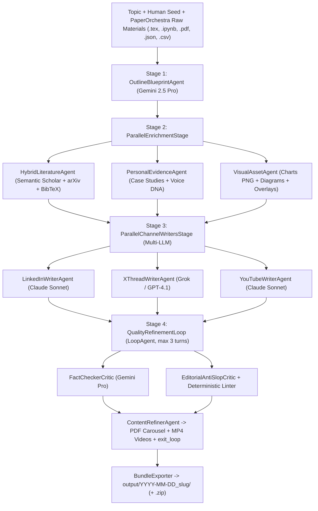

# Research-to-Brand Multi-LLM Agent System (v2)

A **Multi-LLM, PaperOrchestra-inspired AI agent system** built on **Google ADK** (`SequentialAgent` + `ParallelAgent` + `LoopAgent` + `LiteLlm`) that transforms raw R&D materials (`.tex`, `.bib`, `.ipynb`, `.pdf`, `.json`, `.csv`) and a short human angle into ready-to-publish authority assets for **LinkedIn**, **X (Twitter)**, **YouTube**, and optional **Newsletter**.

---

## What Changed in v2

- **PaperOrchestra Ingestion Bridge (`src/ingestion.py`)**: Directly ingests LaTeX manuscripts, BibTeX files, Jupyter notebooks, PDFs, and benchmark logs so content is grounded in *your* real experiments rather than generic topic summaries.
- **Per-Channel Multi-LLM Routing (`src/llm_router.py`)**: Uses the strongest LLM for each job via Google ADK `Gemini` + `LiteLlm` (Gemini 2.5 Pro/Flash for research, ingestion & visuals; Claude Sonnet for LinkedIn & YouTube voice; Grok / GPT-4.1 for X threads; cross-family critic for unbiased peer review) — with automatic fallback to Gemini if optional keys are absent.
- **Verified Multi-Source Literature Grounding (`src/tools.py`, `src/research_sources.py`)**:
  - **Semantic Scholar Graph API** + **OpenAlex API** (250M+ papers incl. Econometrics, Finance & AdTech)
  - **HuggingFace Daily Papers** (trending AI/Agent papers + GitHub repos)
  - **alphaXiv** (structured Markdown overviews for arXiv papers; also supports optional `ALPHAXIV_API_KEY`)
  - **HAL Open Archive** (French academic research — ideal for CIR/CII dossiers)
  - **arXiv** (relevance-sorted search + in-memory **full-text PDF reader** capped at 15 MB)
  - **Curated Industry RSS Feeds** (allowlisted AdExchanger, Digiday, IAB Tech Lab, HF Blog, Google Research Blog via `defusedxml`)
  - Sequential citation verification + `.bib` BibTeX export directly reusable in LaTeX / PaperOrchestra.
- **Visual & Short Demo Video Engine (`src/visuals.py`, `src/video_assets.py`)**:
  - Editorial high-DPI Matplotlib charts & architecture diagrams (`.png` + `.mmd`)
  - Ready-to-upload **LinkedIn 4:5 PDF Carousels**
  - Automated **30–60s MP4 short explainer videos** via FFmpeg (`16:9` for X/YouTube & `9:16` for YouTube Shorts/LinkedIn) + synchronized `.srt` subtitles
  - Timed **Live Demo Shotlist** (`demo_shotlist.md`) + transparent PNG overlays for 5-minute screen recordings
- **Anti-AI-Slop Quality Gate (`LoopAgent`, max 3 iterations)**: Combines a Scientific Fact-Checker, a Cross-Family CTO Editorial Critic, and a deterministic Python linter (catches placeholders `[...]`, broken LinkedIn Markdown `**`, tweets > 280 chars, and banned clichés FR/EN).
- **Personal Knowledge Base (`knowledge/`)**: Grounded in your verified case studies, metrics, and Voice DNA (gitignored locally; generic templates tracked in `knowledge.example/`).

---

## Architecture



---

## Quick Start

```bash
# 1. Create a Python 3.11+ environment and install dependencies
uv venv --python 3.11
source .venv/bin/activate
uv pip install -e ".[dev,ui]"

# 2. Configure API keys (.env)
cp .env.example .env
# Add GOOGLE_API_KEY (required) and optionally ANTHROPIC_API_KEY, OPENAI_API_KEY, XAI_API_KEY

# 3. Inspect active Multi-LLM routing
python main.py --models

# 4. Initialize your personal profile & knowledge base
python main.py --init-profile
python main.py --init-knowledge

# 5. Launch Gradio Studio v2 (http://localhost:7860)
python ui_app.py
```

### CLI Usage (with PaperOrchestra Raw Materials)

```bash
python main.py \
  --topic "Frugal Hybrid MFA Detection at Scale" \
  --input-dir examples/sample_mfa_experiment \
  --seed "En production AdTech, l'économie unitaire (<0.001€/page) bat la précision pure sur notebook." \
  --channels linkedin,x,youtube \
  --lang fr
```

Each run exports a self-contained ready-to-post bundle under `output/YYYY-MM-DD_<slug>/` (plus a `.zip` archive):
- `linkedin_post.txt` + `linkedin_carousel.pdf`
- `x_thread.md`
- `youtube_package.md` (CTR titles, thumbnail briefs, long script, 60s Short script, live demo shotlist, SEO chapters)
- `figures/` (`.png` charts, architecture diagrams, `.mmd` Mermaid, transparent overlays)
- `videos/` (`demo_explainer_16x9.mp4`, `short_9x16.mp4`, `.srt` subtitles)
- `references.bib` (verified BibTeX ready for LaTeX / PaperOrchestra)
- `quality_report.md` & `bundle.json`

---

## Development & Tests

```bash
make check   # ruff format --check & ruff check
make test    # pytest unit suite (offline/mocked + real PNG/PDF/MP4 rendering)
```
